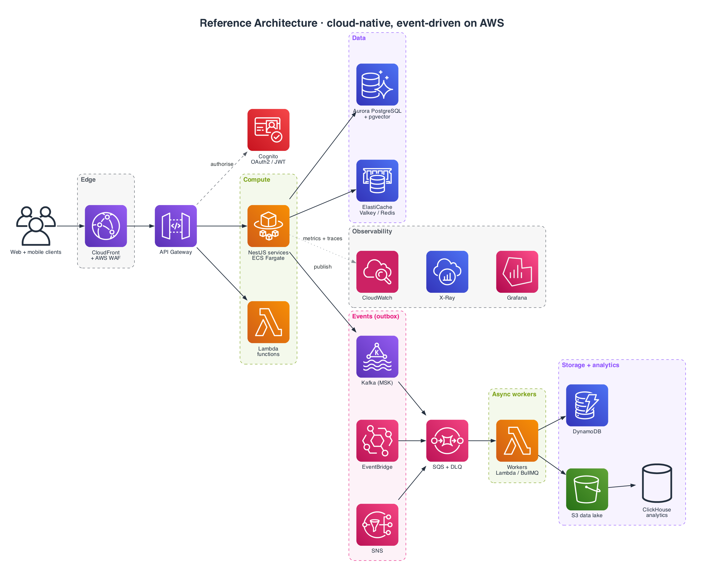
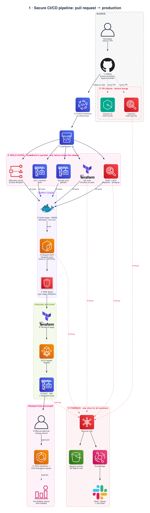
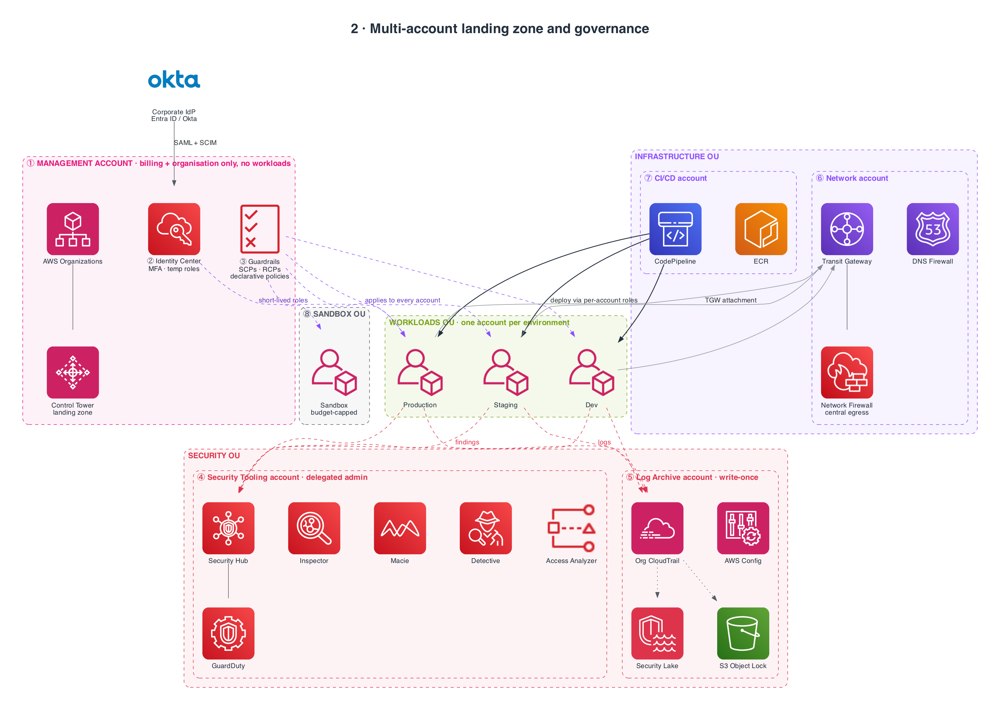
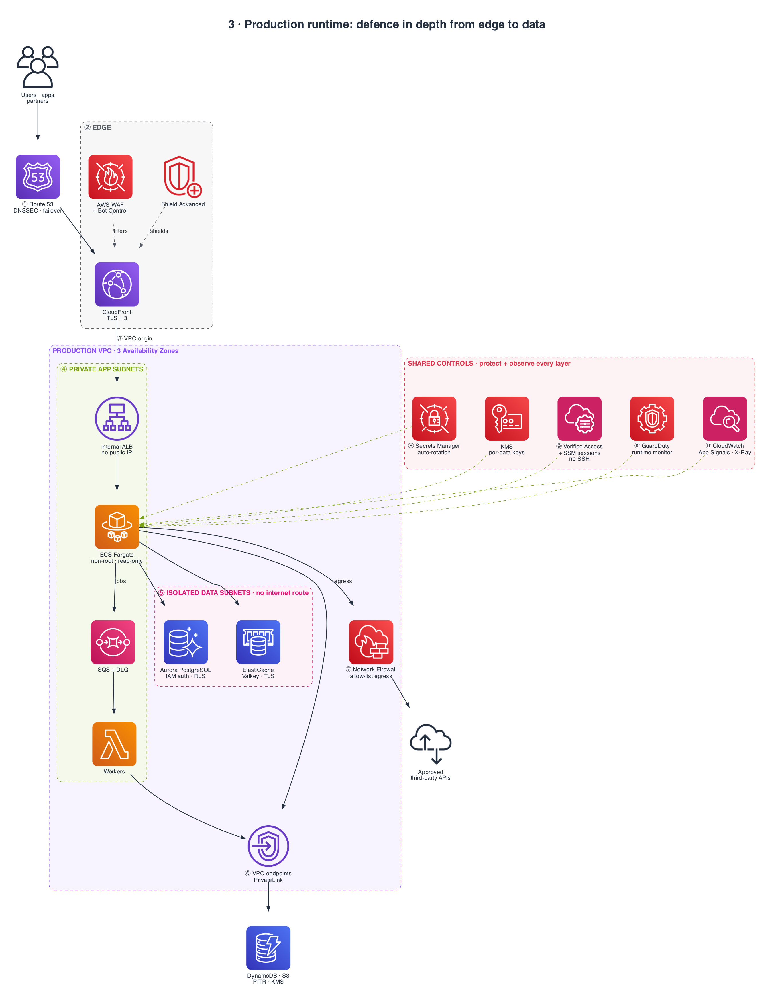
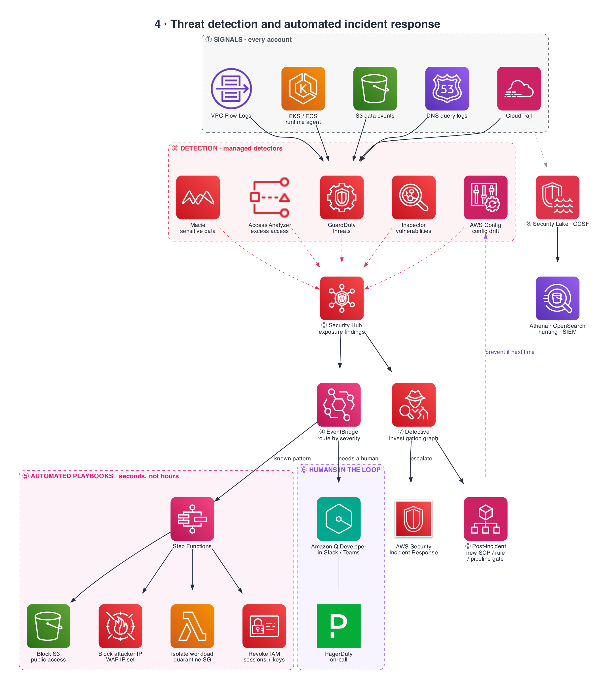

<h1 align="center">Aqeel Raza</h1>
<h3 align="center">Senior Backend Engineer · Solutions Architect · AWS Cloud</h3>

  I design, build and run cloud-native distributed systems on AWS: event-driven microservices,
  serverless platforms, high-throughput data pipelines and AI retrieval services.

  
  
  

---

### About

- **7+ years** building production backends, with the last 4+ years in senior and lead roles
- I own the architecture end to end: domain modelling, service boundaries, data design, cloud topology, CI/CD, observability and cost
- I've led backend teams of 4–6 engineers across 6+ client platforms in healthcare, fintech/Web3, media, logistics, government and HR tech
- I've moved monoliths to **event-driven microservices (CQRS, Saga, DDD)**, which cut infrastructure cost by **25%**
- Recently I've been building **production RAG systems**: embeddings, pgvector HNSW retrieval and Cohere reranking
- Currently preparing for **AWS Certified Solutions Architect – Associate (SAA-C03)**

---

### ☁️ Cloud & Architecture Focus

| Area | What I do |
|---|---|
| **Compute** | Lambda, API Gateway, EC2, ECS/Fargate. Picking serverless vs containers per workload, tuning cold starts, autoscaling on queue depth and p95 latency |
| **Data** | RDS/Aurora PostgreSQL, DynamoDB, ElastiCache Redis, S3, ClickHouse. Access-pattern-first modelling, read/write segregation, caching tiers with stampede control |
| **Messaging** | Kafka, SQS, SNS, EventBridge, BullMQ. Fan-out, DLQs, idempotent consumers, transactional outbox, Saga orchestration |
| **Infrastructure as Code** | Terraform, CloudFormation, AWS CDK. Reproducible multi-environment stacks |
| **Security** | IAM least privilege, Cognito, OAuth 2.0 / JWT, KMS encryption, PostgreSQL Row-Level Security for multi-tenancy, GDPR-aware data handling |
| **Delivery** | GitHub Actions, GitLab CI, CodeDeploy, Jenkins. Blue/green and canary releases with automated rollback |
| **Observability** | CloudWatch, X-Ray, Prometheus, Grafana, ELK, Datadog. RED/USE metrics, structured logs, correlation IDs, SLO-driven alerting |
| **Cost & Reliability** | Right-sizing, moving suitable workloads to Lambda + SQS, Well-Architected reviews |

---

### 🧭 Reference Architecture I Typically Deliver

**Principles I hold to:** idempotent writes · retries with backoff and jitter · circuit breakers · outbox for consistency · least-privilege IAM · everything in IaC · observability from day one · design for cost.

---

### 🔐 DevSecOps & Production Architectures on AWS (2026)

Four blueprints I use when designing secure platforms on AWS, drawn with the official AWS Architecture Icons. The numbers in each diagram match the step tables underneath. Click a diagram to open it full size.
They update the classic [2021 AWS DevSecOps pipeline](https://aws.amazon.com/blogs/devops/building-end-to-end-aws-devsecops-ci-cd-pipeline-with-open-source-sca-sast-and-dast-tools/) for 2026: GitHub + CodeConnections replaces CodeCommit, Amazon Inspector code security replaces CodeGuru Security (retired Nov 2025), images are signed, and Security Hub correlates findings natively instead of through a custom Lambda.

<b>1 · Secure CI/CD pipeline: from pull request to production</b>

 

| # | What happens | Why it matters | Where (service / tool) |
|---|---|---|---|
| ① | Code reaches a protected branch only through a reviewed, signed PR | Nobody can push straight to production code; every change is traceable to a person | GitHub branch rules, CODEOWNERS, commit signing |
| ② | Code, dependencies and IaC are scanned while the PR is open | Developers fix issues before merge, when they are cheapest | Amazon Inspector code security, Amazon Q Developer |
| ③ | Merge triggers the pipeline over a managed connection | No long-lived Git or AWS keys sitting in CI | AWS CodeConnections → CodePipeline V2 |
| ④ | Five security and quality gates run in parallel; one failure stops the release | Fast feedback, and nothing unscanned can reach a build | CodeBuild + gitleaks, Inspector/Semgrep, Checkov, IAM Access Analyzer, Jest |
| ⑤ | A minimal, non-root image is built together with its SBOM | Smaller attack surface; the SBOM lets you answer "are we affected by CVE-X?" in minutes | Docker distroless, Inspector SBOM Generator |
| ⑥ | The image is stored with immutable tags and scanned; CRITICAL CVEs block the release | The image that was tested is the image that ships | Amazon ECR + Inspector enhanced scanning, KMS |
| ⑦ | The image is cryptographically signed | Proves the artifact came from this pipeline and was not tampered with | AWS Signer (Notation) |
| ⑧ | Infrastructure and app deploy to an isolated staging account | Production-like test without production blast radius | Terraform, ECS Fargate, cross-account deploy role |
| ⑨ | The running app is attacked like a real user would (DAST) and integration tests run | Catches runtime issues static scans miss: auth gaps, headers, injection | ZAP, CodeBuild |
| ⑩ | A human approves, with a linked change record | Accountability and an audit trail for regulated releases | CodePipeline manual approval |
| ⑪ | The signature is verified, then traffic shifts blue → green with automatic rollback | Zero-downtime release; bad deploys revert without anyone paging in | ECS native blue/green, CloudWatch alarms |
| ⑫ | All findings land in one place and route to the owning team | One backlog of risk instead of five tool dashboards | AWS Security Hub, EventBridge, Jira, S3 Object Lock |

<b>2 · Multi-account landing zone and governance</b>

 

| # | What happens | Why it matters | Where (service / tool) |
|---|---|---|---|
| ① | The management account owns only the organisation and billing | If it holds no workloads, a compromised app can never reach org-level control | AWS Organizations, Control Tower |
| ② | Everyone signs in through the company IdP and gets temporary, role-based access | No IAM users or long-lived keys; leavers lose access the moment HR disables them | IAM Identity Center, Entra ID / Okta |
| ③ | Org-wide rules stop the dangerous actions (leaving the org, disabling logs, public S3, unapproved regions) | Guardrails hold even when an admin makes a mistake | SCPs, Resource Control Policies, declarative policies |
| ④ | One account runs every security service for the whole organisation | Security has a single view; workload teams can't switch the tools off | Security Hub, GuardDuty, Inspector, Macie, Detective, Access Analyzer |
| ⑤ | All audit logs flow into a locked, write-once account | Attackers can't erase their tracks; evidence is ready for audits and forensics | CloudTrail org trail, AWS Config, S3 Object Lock, Security Lake |
| ⑥ | All traffic between VPCs and out to the internet passes through central inspection | One place to allow-list egress and block data exfiltration | Transit Gateway, AWS Network Firewall, Route 53 Resolver DNS Firewall |
| ⑦ | Pipelines live in their own account and deploy through narrow per-account roles | CI compromise can't touch prod data; deploys are the only path in | CodePipeline, ECR, AWS Signer, cross-account IAM roles |
| ⑧ | Experiments run in throwaway accounts with spend limits | Teams can innovate without risking production or the budget | AWS Budgets actions, automated cleanup |

<b>3 · Production runtime: defence in depth from edge to data</b>

 

| # | What happens | Why it matters | Where (service / tool) |
|---|---|---|---|
| ① | DNS is signed and fails over automatically between healthy endpoints | Stops DNS spoofing and keeps the service up during a regional issue | Route 53, DNSSEC, health checks |
| ② | Every request is terminated and filtered at the edge | OWASP attacks, bots and DDoS are stopped before they reach your VPC | CloudFront, AWS WAF, Shield Advanced |
| ③ | CloudFront reaches the load balancer privately | The app has no public entry point that could bypass WAF | CloudFront VPC origins, internal ALB |
| ④ | Containers run in private subnets as non-root with a read-only filesystem; slow work goes through queues | Smaller blast radius if code is exploited; spikes are absorbed without dropping requests | ECS Fargate, SQS with DLQ, Lambda |
| ⑤ | Databases sit in subnets with no internet route and enforce tenant isolation in the DB itself | Even a compromised app server can't exfiltrate directly or read other tenants' rows | Aurora PostgreSQL (IAM auth, Row-Level Security), ElastiCache Valkey |
| ⑥ | AWS APIs are reached over private endpoints | Traffic to S3, KMS and Secrets Manager never crosses the internet | VPC interface and gateway endpoints |
| ⑦ | Outbound internet goes only to an allow-listed set of domains | Blocks command-and-control callbacks and data exfiltration | AWS Network Firewall |
| ⑧ | Credentials are fetched at runtime and rotate on their own; data is encrypted with separate keys | No secrets in code or env files; a leaked key is short-lived and scoped | Secrets Manager, AWS KMS |
| ⑨ | Human access goes through identity-aware, logged sessions | No open SSH ports or shared bastion keys; every command is auditable | AWS Verified Access, SSM Session Manager / ECS Exec |
| ⑩ | Container behaviour is monitored for crypto-miners, reverse shells and privilege escalation | Detects attacks that got past every preventive control | GuardDuty Runtime Monitoring |
| ⑪ | Every request is traced and measured against SLOs | Security and reliability issues show up as anomalies quickly | CloudWatch Application Signals, X-Ray, OpenTelemetry |

<b>4 · Threat detection and automated incident response</b>

 

| # | What happens | Why it matters | Where (service / tool) |
|---|---|---|---|
| ① | API calls, network flows, DNS lookups, Kubernetes audit logs and container runtime events are collected from every account | You can't detect what you don't log | CloudTrail, VPC Flow Logs, Route 53 Resolver logs, EKS audit logs, GuardDuty runtime agent (ECS · EKS · EC2), S3 data events |
| ② | Managed detectors look for threats, vulnerabilities, exposed data, misconfiguration and over-permissive access | Covers attackers, weaknesses and mistakes, not just one of them | GuardDuty, Inspector, Macie, AWS Config, IAM Access Analyzer |
| ③ | Findings are deduplicated and correlated into attack paths with a single severity | Teams fix the 5 issues that form a real exposure, not 500 isolated alerts | AWS Security Hub (exposure findings) |
| ④ | Each finding is routed by severity and resource type | The right automation or team gets it within seconds | Amazon EventBridge |
| ⑤ | Known attack patterns are contained automatically | Containment in seconds instead of hours, even at 3 a.m. | AWS Step Functions, Lambda, Security Groups, IAM, S3 Block Public Access, AWS WAF |
| ⑥ | Humans are paged with context and one-click actions in chat | Faster triage without logging into five consoles | Amazon Q Developer in chat applications, PagerDuty |
| ⑦ | Analysts trace the blast radius and can escalate to AWS responders | Root cause and scope are found from linked evidence, not guesswork | Amazon Detective, AWS Security Incident Response |
| ⑧ | All security data is normalised and kept long-term | Threat hunting, compliance evidence and SIEM integration from one open format | Amazon Security Lake (OCSF), Athena, OpenSearch |
| ⑨ | Every incident ends with a new preventive control | The same attack can't succeed twice; security gets stronger over time | SCPs, AWS Config rules, new CI/CD gates |

---

### 💼 Experience

**Exagic** · *Senior Backend Developer / Backend Lead* · Jan 2024 – Present · Remote
- Lead the backend team. I set engineering standards, review architecture and code, and own delivery
- Architect cloud-native AWS platforms (Lambda, EC2, S3, RDS, DynamoDB, SQS), all provisioned with **Terraform**
- Build event-driven pipelines on **Kafka + SQS**, tuning PostgreSQL/MongoDB indexes and Redis caching for high-volume workloads
- Ship RAG-based document search: chunking, embeddings, **pgvector** retrieval and **Cohere** reranking
- Run Docker CI/CD with blue/green deployments, with observability through Prometheus, Grafana and ELK

**Funavry Technologies** · *Senior Software Engineer / Technical Lead* · Dec 2021 – Apr 2024
- Owned backend architecture and technical decisions across **6+ client platforms**, leading teams of 4–6
- Moved monoliths to **event-driven microservices (CQRS + Saga)**, which cut infrastructure cost by **25%**. I also standardised AWS deployments with GitHub Actions
- Built the API and SDK infrastructure for **[ChainGPT](https://www.chaingpt.org/)** (smart-contract generation, auditing, NFT creation, on-chain analytics)
- Delivered a **NestJS EHR platform** for a US healthcare client: prescriptions, patient records and multi-provider workflows with audit trails
- Made the **Kalba Municipality** portal **35% faster** through query optimisation and caching. Also delivered media and e-commerce logistics backends

**SmartRecruitOnline – [Occy](https://occy.com/)** · *Backend Developer* · Nov 2019 – Dec 2021
- Built the core API layer for an enterprise ATS used by UK hiring teams, covering sourcing, pipelines and interview scheduling
- Automated email/SMS, reference checks, background verification and e-signature workflows across PostgreSQL, MongoDB and DynamoDB

**[PackageX](https://packagex.io/)** · *Node.js Developer* · Mar 2018 – Sep 2019
- Built serverless integrations on **AWS Lambda + API Gateway** for a logistics platform, tuned for performance

---

### 🚀 Featured Work

| Project | What it is | Stack |
|---|---|---|
| **RegLens UK** | RegTech platform with **RegBot**, an AI regulatory assistant using hybrid RAG. A DDD rules engine turns legal provisions into nightly validation audits and cut analytical resolution time from **4 days to 4 hours**. Tenants are isolated with PostgreSQL RLS | NestJS · PostgreSQL · pgvector HNSW · Cohere · DDD |
| **[AuthKit – Cognito Passwordless Kit](https://github.com/aqeelrazagondal/Cognito-Passwordless-Kit)** | Production-grade passwordless auth for AWS (OTP + magic links) | NestJS · AWS CDK · Cognito · Lambda |
| **[Lambda Cold-Start Analyzer](https://github.com/aqeelrazagondal/lambda-ColdStart-analyzer)** | Multi-account, multi-region platform tracking Lambda cold starts (P50/P90/P99), bundle analysis and alerts via cross-account AssumeRole | TypeScript · CloudWatch Logs Insights · IAM |
| **[ChainGPT](https://www.chaingpt.org/)** | AI + Web3 API/SDK platform with queued job processing, rate limiting and request tracing | Node.js · AWS · Redis · Queues |
| **Secure EHR Platform** | Multi-provider healthcare records with RBAC, audit trails and encryption at rest | NestJS · PostgreSQL · AWS KMS |

> Most of my production work is private or client-owned. I'm glad to walk through architecture decisions and anonymised designs on request.

---

### 🛠️ Tech Stack

**Languages & Frameworks**
 

**AWS & Infrastructure**
 

**Data & Messaging**
 

**Delivery & Observability**
 

---

### 🎓 Certifications

- **AWS Certified Solutions Architect – Associate (SAA-C03)**: in progress
- AWS Lambda & Serverless Architecture Bootcamp (Udemy)
- Node.js: Complete Guide to Building RESTful APIs (Udemy)
- Elasticsearch Essential Training (Lynda.com)
- BSc Computer Science, Preston University Islamabad

---

### 🤝 Open To

Senior Backend, Lead Engineer, Solutions Architect and Cloud Architect roles, in the UK or remote.
Happy to talk about **AWS architecture, event-driven design, platform modernisation and production RAG systems**.
