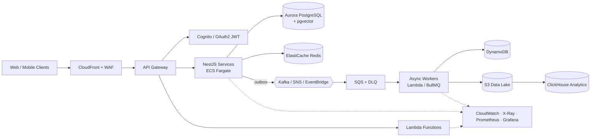

<h1 align="center">Aqeel Raza</h1>
<h3 align="center">Senior Backend Engineer · Solutions Architect · AWS Cloud</h3>

  I design, build and run cloud-native distributed systems on AWS: event-driven microservices,
  serverless platforms, high-throughput data pipelines and AI retrieval services.

  
  
  

---

### About

- **7+ years** building production backends, with the last 4+ years in senior and lead roles
- I own the architecture end to end: domain modelling, service boundaries, data design, cloud topology, CI/CD, observability and cost
- I've led backend teams of 4–6 engineers across 6+ client platforms in healthcare, fintech/Web3, media, logistics, government and HR tech
- I've moved monoliths to **event-driven microservices (CQRS, Saga, DDD)**, which cut infrastructure cost by **25%**
- Recently I've been building **production RAG systems**: embeddings, pgvector HNSW retrieval and Cohere reranking
- Currently preparing for **AWS Certified Solutions Architect – Associate (SAA-C03)**

---

### ☁️ Cloud & Architecture Focus

| Area | What I do |
|---|---|
| **Compute** | Lambda, API Gateway, EC2, ECS/Fargate. Picking serverless vs containers per workload, tuning cold starts, autoscaling on queue depth and p95 latency |
| **Data** | RDS/Aurora PostgreSQL, DynamoDB, ElastiCache Redis, S3, ClickHouse. Access-pattern-first modelling, read/write segregation, caching tiers with stampede control |
| **Messaging** | Kafka, SQS, SNS, EventBridge, BullMQ. Fan-out, DLQs, idempotent consumers, transactional outbox, Saga orchestration |
| **Infrastructure as Code** | Terraform, CloudFormation, AWS CDK. Reproducible multi-environment stacks |
| **Security** | IAM least privilege, Cognito, OAuth 2.0 / JWT, KMS encryption, PostgreSQL Row-Level Security for multi-tenancy, GDPR-aware data handling |
| **Delivery** | GitHub Actions, GitLab CI, CodeDeploy, Jenkins. Blue/green and canary releases with automated rollback |
| **Observability** | CloudWatch, X-Ray, Prometheus, Grafana, ELK, Datadog. RED/USE metrics, structured logs, correlation IDs, SLO-driven alerting |
| **Cost & Reliability** | Right-sizing, moving suitable workloads to Lambda + SQS, Well-Architected reviews |

---

### 🧭 Reference Architecture I Typically Deliver

**Principles I hold to:** idempotent writes · retries with backoff and jitter · circuit breakers · outbox for consistency · least-privilege IAM · everything in IaC · observability from day one · design for cost.

---

### 💼 Experience

**Exagic** · *Senior Backend Developer / Backend Lead* · Jan 2024 – Present · Remote
- Lead the backend team. I set engineering standards, review architecture and code, and own delivery
- Architect cloud-native AWS platforms (Lambda, EC2, S3, RDS, DynamoDB, SQS), all provisioned with **Terraform**
- Build event-driven pipelines on **Kafka + SQS**, tuning PostgreSQL/MongoDB indexes and Redis caching for high-volume workloads
- Ship RAG-based document search: chunking, embeddings, **pgvector** retrieval and **Cohere** reranking
- Run Docker CI/CD with blue/green deployments, with observability through Prometheus, Grafana and ELK

**Funavry Technologies** · *Senior Software Engineer / Technical Lead* · Dec 2021 – Apr 2024
- Owned backend architecture and technical decisions across **6+ client platforms**, leading teams of 4–6
- Moved monoliths to **event-driven microservices (CQRS + Saga)**, which cut infrastructure cost by **25%**. I also standardised AWS deployments with GitHub Actions
- Built the API and SDK infrastructure for **[ChainGPT](https://www.chaingpt.org/)** (smart-contract generation, auditing, NFT creation, on-chain analytics)
- Delivered a **NestJS EHR platform** for a US healthcare client: prescriptions, patient records and multi-provider workflows with audit trails
- Made the **Kalba Municipality** portal **35% faster** through query optimisation and caching. Also delivered media and e-commerce logistics backends

**SmartRecruitOnline – [Occy](https://occy.com/)** · *Backend Developer* · Nov 2019 – Dec 2021
- Built the core API layer for an enterprise ATS used by UK hiring teams, covering sourcing, pipelines and interview scheduling
- Automated email/SMS, reference checks, background verification and e-signature workflows across PostgreSQL, MongoDB and DynamoDB

**[PackageX](https://packagex.io/)** · *Node.js Developer* · Mar 2018 – Sep 2019
- Built serverless integrations on **AWS Lambda + API Gateway** for a logistics platform, tuned for performance

---

### 🚀 Featured Work

| Project | What it is | Stack |
|---|---|---|
| **RegLens UK** | RegTech platform with **RegBot**, an AI regulatory assistant using hybrid RAG. A DDD rules engine turns legal provisions into nightly validation audits and cut analytical resolution time from **4 days to 4 hours**. Tenants are isolated with PostgreSQL RLS | NestJS · PostgreSQL · pgvector HNSW · Cohere · DDD |
| **[AuthKit – Cognito Passwordless Kit](https://github.com/aqeelrazagondal/Cognito-Passwordless-Kit)** | Production-grade passwordless auth for AWS (OTP + magic links) | NestJS · AWS CDK · Cognito · Lambda |
| **[Lambda Cold-Start Analyzer](https://github.com/aqeelrazagondal/lambda-ColdStart-analyzer)** | Multi-account, multi-region platform tracking Lambda cold starts (P50/P90/P99), bundle analysis and alerts via cross-account AssumeRole | TypeScript · CloudWatch Logs Insights · IAM |
| **[ChainGPT](https://www.chaingpt.org/)** | AI + Web3 API/SDK platform with queued job processing, rate limiting and request tracing | Node.js · AWS · Redis · Queues |
| **Secure EHR Platform** | Multi-provider healthcare records with RBAC, audit trails and encryption at rest | NestJS · PostgreSQL · AWS KMS |

> Most of my production work is private or client-owned. I'm glad to walk through architecture decisions and anonymised designs on request.

---

### 🛠️ Tech Stack

**Languages & Frameworks**
 

**AWS & Infrastructure**
 

**Data & Messaging**
 

**Delivery & Observability**
 

---

### 🎓 Certifications

- **AWS Certified Solutions Architect – Associate (SAA-C03)**: in progress
- AWS Lambda & Serverless Architecture Bootcamp (Udemy)
- Node.js: Complete Guide to Building RESTful APIs (Udemy)
- Elasticsearch Essential Training (Lynda.com)
- BSc Computer Science, Preston University Islamabad

---

### 🤝 Open To

Senior Backend, Lead Engineer, Solutions Architect and Cloud Architect roles, in the UK or remote.
Happy to talk about **AWS architecture, event-driven design, platform modernisation and production RAG systems**.

  
  

